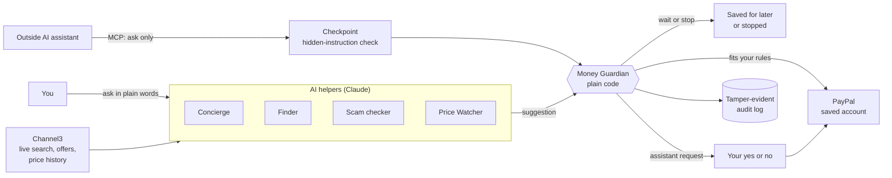

# North

**AI can spend your money now. Not without your rules.**

North is an AI money helper, built first for adults with cognitive disabilities. It makes online shopping easier and keeps your money safe, on your own terms. You set the rules. North keeps them, even against an AI.

**AI suggests. Code decides.**

Built solo for the PayPal AI Hackathon 2026.

- **Live app:** https://north-sage-tau.vercel.app
- **Try the demo:** click **Try the demo** on the front page, no signup
- **Demo video:** https://youtu.be/6KJDmRex4Zc

---

## For judges: try it in 10 seconds

1. Open https://north-sage-tau.vercel.app and click **Try the demo**.
2. You land in a seeded week: $95.01 spent of a $400 plan, $1,200 for rent and bills locked away, one scam already stopped, one item saved for later, one refund, and one request from an AI assistant waiting for your yes or no.
3. **Menu → Demo tools** lets you **Start fresh** (rebuild the demo week) or set a **pretend hour** (try 11 PM to see the night rule).
4. Payments run in the **PayPal sandbox**, so nothing is really charged and nothing is shipped.

Things to try:
- **Find:** search for "running shoes" to see live prices from several stores, then open one. Shoes and clothes ask you to pick a size first.
- **Buy something small:** one tap, checked by your rules, paid with your saved PayPal.
- **Buy the $349 headphones:** North stops it, because it would dip into the rent money.
- **Home → Check a deal:** paste a fake deal, for example "Running shoes now $19.99 (was $145). Only 2 left!", and see the scam check compare it with real store prices.
- **The banner on Home:** answer the AI assistant's request with Yes or No.
- **Menu → Demo tools → Try to break North:** type any trick as an AI assistant and watch the Money Guardian decide, live.

> **Demo store disclosure.** Channel3 offers check out on each retailer's own site. So that PayPal payments can work end to end, North pays a **sandbox demo store** stocked with real Channel3 products. No real money moves and no real purchase is made at any retailer. The prices and products are real; the payment and the order are practice only.

---

## Why North

It's eleven at night. You can't sleep. An ad says "only two left." You tap Buy, then another, and another. By morning, the rent money is gone.

- About **1 in 7 US adults (13.9%)** report serious difficulty concentrating, remembering or making decisions ([CDC Disability and Health Data](https://www.cdc.gov/disability-and-health/articles-documents/disability-impacts-all-of-us-infographic.html)).
- Consumers reported **$15.9 billion in fraud losses in 2025**, up from over $12 billion the year before ([FTC](https://www.ftc.gov/news-events/news/press-releases/2026/03/ftc-testifies-joint-economic-committee-agencys-efforts-combat-fraud)).
- Online shopping is designed to make us buy fast, with countdown timers, one-tap checkout and fake deals. And now AI assistants can shop and pay for us, even faster.

Today the usual safety net is handing your card to someone else. That keeps the money safe, but it takes away independence. North is a third option: you stay in control, and your own rules are enforced every time.

---

## What it does

| Feature | What it means for you |
| --- | --- |
| **Your week, your rules** | Set a weekly amount, lock away rent and bills, and write rules in your own words, like "wait a day on buys after 9pm". You choose how strict each rule is: Gentle (you can still Buy now), Firm (saved for tomorrow) or Locked (never). Making a rule stricter starts right away. Making it weaker, or spending more, starts tomorrow, so a late-night impulse can't unlock the rent. |
| **Ask in plain words** | North searches real stores live with Channel3, compares prices across stores, and tells you what something costs in things you can picture ("about 3 weeks of groceries"). Ask with words or with a photo, or take a photo of something that ran out and buy it again. |
| **One tap when it fits** | The Money Guardian checks the buy against your rules, then PayPal pays from your saved account. You see exactly what's left this week. |
| **Choose your size** | Shoes, clothes and rings show the store's own sizes as big buttons, and "Buy this" waits until you pick one. North can remember your usual size on your device. If a store gives no size data, North says so instead of guessing. |
| **Wait, don't lose it** | At night, or over a limit, North saves the item for tomorrow, watches its price and tells you if it drops. |
| **Scams don't get through** | Paste a link or ad, or add a screenshot. North compares the price with real store offers and, where Channel3 tracks the product, its last 30 days of prices. It also checks the seller, and warns when a cheapest price looks too far below the other stores. |
| **Rent is off limits** | A buy that would dip into rent and bills money is stopped. Nothing is charged. Not even "Buy now" gets past it. |
| **AI assistants have to ask** | Connect any MCP-compatible AI assistant with its own key you can switch off. It can ask to buy, but it never gets your PayPal. North runs the same checks, and you get one simple yes or no. |
| **Built for the way you think** | Every screen can read itself out loud. Big buttons, one choice at a time, plain words, 5 themes in light and dark, and a reduce-motion setting. |
| **Money back and receipts** | Refunds, PayPal receipts, "Did my last order go through?" (a read-only lookup through the PayPal Agent Toolkit), and a tamper-evident log of every decision. |

---

## How it works



- **Four AI helpers (Claude)** find, compare and check: Concierge, Finder, Scam checker and Price Watcher. **None of them can pay.** Anything a helper says that becomes a price, a number or a rule is checked and written by code, never taken from model text.
- **The Money Guardian** is the only path to a payment, and it is **plain, deterministic code**, not an LLM. It checks every buy against your weekly amount, your locked rent and bills, and your rules. AI output can only make it stricter, never approve a buy.
- **Approvals are signed, work once and expire after 2 minutes**, so an old or copied approval can't be reused.
- **Outside AI assistants** connect through an **MCP checkpoint**. Their requests are scanned for hidden instructions, go through the same Guardian, and then wait for your yes or no.
- **Every decision** is written to a **tamper-evident audit log** that you can verify with `npm run audit:verify`.

### Built with

| Part | Used for |
| --- | --- |
| **Next.js 16 + TypeScript** | The app, deployed on **Vercel** |
| **Supabase** | Login and data storage |
| **Vercel cron jobs** | A daily price check and the daily reset of the demo week (both protected by a secret) |
| **PayPal (sandbox)** | Vaulted payment methods, Orders v2, refunds, verified webhooks, and the Agent Toolkit for read-only order and transaction lookups |
| **Channel3** | Live product search, multi-store offers, and price history |
| **Claude (Anthropic)** | The four AI helpers |
| **MCP** | The checkpoint for outside AI assistants |

---

## Security and testing

- **AI suggests, code decides.** No model can approve or make a payment. A structure test checks that agent code never imports checkout, charge or refund code.
- **612 attacks** from North's own AI red team (Claude Haiku 4.5, run on Nov 8) against the Money Guardian and the web routes, in 10 categories: poisoned listings, prompt injection, fake urgency, price and quantity tampering, replayed approvals, races, revoked assistant keys, demo-tool abuse, login and CSRF attacks, and rule loosening. **0 got through**, and no money moved against the rules. Run `npm run attack -- --rounds 2` to try it yourself.
- **Scam check eval:** 32 of 32 verdicts correct, 0 missed scams, 0 false alarms, and 10 listings with hidden instructions that the real model did not follow. The cases were written by the developer with Claude's help, so this is a smoke test, not proof.
- **1,900+ unit tests**, including property tests on the Guardian, plus an end-to-end script against the real PayPal sandbox with verified webhooks (`scripts/e2e-with-tunnel.sh`).
- **Accessibility:** axe checks on every page in light and dark modes across all five themes, and a 16px minimum text check.
- **The demo is safe to explore:** demo-only tools are on only when the deployment is explicitly marked as a demo, and they never weaken the rules outside demo mode.
- **Honest limits:** read [docs/security.md](docs/security.md) and [docs/threat-model.md](docs/threat-model.md) for how North is protected, what was tested and what the limits are. The full decision table for the Guardian is in [docs/guardian-decision-table.md](docs/guardian-decision-table.md).

---

## Accessibility: built on W3C COGA

North follows the W3C guidance [Making Content Usable for People with Cognitive and Learning Disabilities (COGA)](https://www.w3.org/TR/coga-usable/).

| COGA objective | How North does it |
| --- | --- |
| Help users understand what things are and how to use them | Plain words everywhere, and prices shown as everyday things ("about 2 lunches") |
| Help users find what they need | Four main places (Home, Find, Saved, Money) and one clear next step on every screen |
| Use clear and understandable content | Short sentences, one idea per line, read-aloud on every screen |
| Help users avoid mistakes and know how to correct them | The Guardian checks every buy, rent money is locked, risky changes wait until tomorrow, and refunds and undo are available |
| Help users focus | One choice at a time, no countdown timers, no fake urgency, reduce-motion setting |
| Ensure processes do not rely on memory | Saved items, reminders, "Did my last order go through?", and remembered sizes (on your device) |
| Provide help and support | "Help is always here" on every screen, plus "How North works" |
| Support adaptation and personalization | 5 themes in light and dark, read-aloud, and rules in your own words |

---

## Run it locally

You need Node.js 20 or newer.

```bash
git clone https://github.com/Yxp23/north.git
cd north
npm install
cp .env.example .env.local   # then fill in your own values
npm run dev
```

`.env.local` is never committed. Server-only values must never start with `NEXT_PUBLIC_`.

**Environment variables** (names only, see `.env.example` for what each one does):

| Group | Variables |
| --- | --- |
| PayPal (sandbox) | `PAYPAL_ENV`, `PAYPAL_CLIENT_ID`, `PAYPAL_CLIENT_SECRET`, `NEXT_PUBLIC_PAYPAL_CLIENT_ID`, `PAYPAL_WEBHOOK_ID` |
| Stores and AI | `CHANNEL3_API_KEY`, `ANTHROPIC_API_KEY` |
| Supabase | `SUPABASE_URL`, `SUPABASE_SECRET_KEY`, `SUPABASE_PUBLISHABLE_KEY` |
| Security (required in production) | `NORTH_SECRET`, `NORTH_SITE_URL`, `CRON_SECRET` |
| Demo | `DEMO_MODE`, `DEMO_DEPLOYMENT`, `DEMO_USER_ID`, `DEMO_LOGIN_EMAIL`, `DEMO_LOGIN_PASSWORD`, `DEMO_AI_DAILY_LIMIT`, `DEMO_STORES_DAILY_LIMIT`, `DEMO_TIME_ZONE` |
| Local development and tests | `LOCAL_LOGIN_EMAIL`, `LOCAL_LOGIN_PASSWORD`, `PAYMENTS_MODE`, `NORTH_DEV_RATE_MULTIPLIER` |
| Recording | `STORE_MODE`, `VIDEO_SAFE` |

**Without Supabase:** leave `SUPABASE_URL` and `SUPABASE_SECRET_KEY` empty and North keeps its data in a local file and uses a local practice login (see `LOCAL_LOGIN_*` in `.env.example`). Setting `PAYMENTS_MODE=simulated` pretends the payments for development and tests. Both are refused in production.

**With Supabase:** run every file in `supabase/migrations/` in order in the Supabase SQL Editor. The app refuses to run without the newest one.

**Scripts** (from `package.json`):

| Command | What it does |
| --- | --- |
| `npm run dev` / `build` / `start` | Run, build and serve the app |
| `npm test` | Unit tests |
| `npm run lint` / `npm run typecheck` | Lint and type checks |
| `npm run test:supabase` | The ledger tests against a real Supabase project |
| `npm run seed:demo` | Rebuild the demo week through the real flows (needs `DEMO_USER_ID`) |
| `npm run audit:verify` | Verify the tamper-evident audit log |
| `npm run eval:scam` | Run the scam-check eval (uses the live AI and stores) |
| `npm run eval:concierge` | Run the rule-writing eval |
| `npm run attack -- --rounds 2` | Run the AI red team against North |
| `npm run proof` | Rebuild the proof numbers shown on "How North works" |

---

## Production work not done here

- PayPal requires risk data (FraudNet) for saved-account token payments in production. It isn't needed in the sandbox.
- Payments run in the PayPal sandbox only, against a demo store (see the disclosure above).
- Every page and route already needs a login, but an independent security review should come before any live-money use. The known limits are listed in [docs/security.md](docs/security.md).

---

## What's next

- **Test with the people North is built for.** I haven't run usability sessions with real users yet, and that comes first. I plan to start by reaching out to Penn State Student Disability Resources.
- **A trusted-person view:** someone you choose can see alerts, but never takes control of your money.
- **Live PayPal payments** after a security review, and more stores through Channel3.

---

## License

MIT. See [LICENSE](LICENSE).
